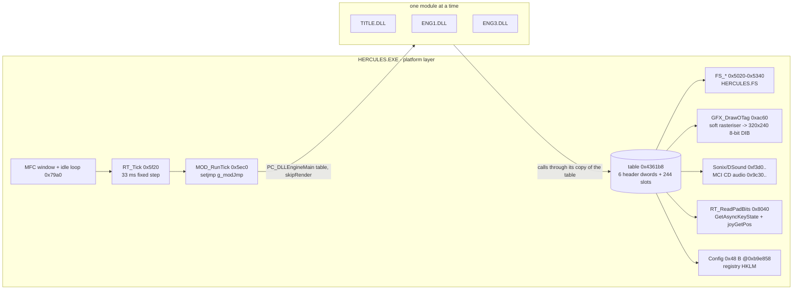
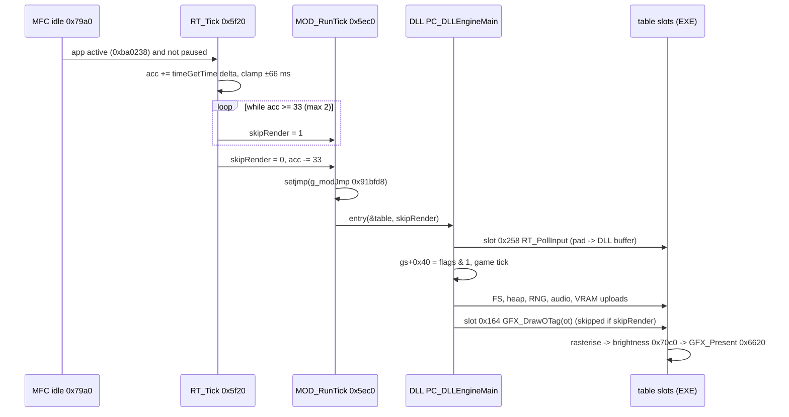

# WASM port — current runtime architecture

How the original game and today's remaster runtime work, reconstructed from the binaries and the existing specs.
RVAs: EXE base 0x400000, DLLs base 0x10000000. Main sources: `docs/module-interface.md`, `docs/binary-map.md`,
`docs/gpu-renderer.md`, `analysis/exports/p2_contract.json`, `analysis/exports/p2_decomp/`.

## 1. Components

| module | role (confirmed) | entry / tick |
|---|---|---|
| HERCULES.EXE | window, clock, input, sound, CD music, archive, allocator, 8-bit software rasteriser, registry | `RT_Startup` 0x5e10, idle 0x79a0 |
| TITLE.DLL | title, menus, options, passwords, save slots, FMV calls; picks the next engine from table 0x22288[gs[0]] (`FUN_10016300`) | tick 0x5fb0 |
| ENG1.DLL | levels TRAINING, FOREST, THEBES, HYDRA, MEDUSA, TITANS, VORTEX; attract demo playback | tick 0x20300 |
| ENG3.DLL | levels GAUNTLET, CYCLOPS, TORMENT | tick 0x1abb0 |

The DLLs never call each other and import nothing from the EXE. Every DLL→EXE call goes through the DLL's private
copy of the 250-dword table (ENG1 0x70f20, ENG3 0x407a0, TITLE 0x2bb40). The KERNEL32 imports are used only by the
statically linked MSVC 5 C runtime (CRT). The one exception is TITLE's save code, which reaches
`CreateFileA`/`ReadFile`/`SetEndOfFile` through CRT `_open`/`_read` (§8).

## 2. Boot

1. `RT_Startup` 0x5e10:
   1. `timeBeginPeriod(1)`.
   2. Read registry `Path`/`Config` (0x4a30, 0x4ce0 → 0xb9e858).
   3. `FS_Init` opens HERCULES.FS.
   4. `GFX_InitDisplay` 0x72a0: DIB 320×−240 8 bpp, DirectDraw.
   5. Joystick init 0x7bb0.
   6. `DirectSoundCreate` 0xfdf0.
   7. `FUN_00401ff0`.
   8. The CD check 0x4ac0 ("You cannot play Hercules without the CD in the drive"). In this edition the flag 0x43a594 is static non-zero, so the game runs without a disc (`P8-expand-package.md` notes).
2. `FUN_00401ff0` (Ghidra, confirmed):
   1. Zeroes gameState (0x6cd dwords) and the 3 MiB arena.
   2. `RT_SetHeapRange`.
   3. Sets `gs[0] = 0xff`, `gs[3] = 0x11`.
   4. **Seeds RNG `gs+0x48 = 0x13546547`, `gs+0x4c = 0xecab9ab8`**.
   5. `FUN_00410a30(0x13546547)` (hypothesis: CRT `srand`).
   6. `MOD_ChangeModule("…", "TITLE")`.
3. The first `MOD_RunTick` loads `title.dll` (`MOD_LoadModule` 0x5c20: FreeLibrary/LoadLibraryA by basename, then
   GetProcAddress `PC_DLLEngineMain`). The loader runs the CRT DllMain.

Because the seed is a constant and input is sampled per tick, a run from boot is deterministic for a given per-tick
pad sequence. That is why the attract demo replays identically (`docs/runtime-launch.md`: demo at tick ≈1134).

## 3. Per-tick flow and timing

- Fixed 33 ms step, about 30.3 presents/s measured (`docs/runtime-launch.md:23`). Logic counts ticks; there is no
  timing slot.
- The EXE drives CD-audio time keeping (0x9cd0) at the start of every `RT_Tick`.

## 4. Module switch (non-local exit)

`MOD_ChangeModule` (slot 0x064 → 0x4040, `p2_decomp/00404040.c`):
1. Frees the block named at gs+0xe4.
2. Resets the heap (slot 0x44).
3. Clears gs+0xb0/0xb4.
4. Sets gs+0x108 = 0x801ffff0.
5. Calls `MOD_RequestModule` 0x5cd0. When a module is running, that sets `g_modSwitch` and calls
   **`longjmp(g_modJmp)`**. The DLL's stack frames are discarded mid-tick.

`MOD_RunTick` then loads the new DLL and runs its first tick in the same host frame. Any port must reproduce:
abandon the guest call stack, unload (DllMain DETACH), load (DllMain ATTACH), call the new entry, all inside one tick.

## 5. EXE → DLL re-entrant calls (callbacks)

| site | mechanism | evidence |
|---|---|---|
| slot 0x02c `FUN_00403f00` | streamed read, 5×0x800 bytes per call. Calls DLL function pointers stored at gs+0xb0/gs+0xb4 | `p2_decomp/00403f00.c` |
| `FUN_0040bd80` (reached from slots 0x140, 0x168, 0x204, 0x20c) | calls the function pointer at EXE 0xa8e780 when 0xa8e788 ≠ 0 (DrawSync-style callback, set by slot 0x284 `FUN_0040bdf0`) | Ghidra decompile 0x40bd80 |
| slot 0x258 `RT_PollInput` | writes into a DLL buffer through the pointer at 0xa8e78c (registered by slot 0x1fc) | `module-interface.md` |

## 6. Rendering path today

**Original:** the DLL builds a PlayStation-style ordering table (OT) of GPU packets and passes it to `GFX_DrawOTag` (slot 0x164). The EXE walks the list. The handled codes are:

| code | primitive |
|---|---|
| 0x24 / 0x2c / 0x3c | textured polys |
| 0x64 / 0x74 / 0x7c | sprites |
| 0xe1 | draw mode |
| 0xf3 | clip |
| 0x01 | image upload |

The EXE rasterises into the 320×240 8-bit DIB, applies brightness and presents. Textures live in an emulated
VRAM at 0x96e6e0, fed by slots 0x204/0x20c. The CIF tables (palette, fog, blend, shade) are loaded by
`GFX_LoadCif` 0x68c0 and `GFX_LoadLevelPalette` (slot 0x244).

**Remaster (Route A, shipping):** `ddraw.dll` proxy in the game folder (`runtime/display/ddraw_proxy.c`):
- detours `GFX_DrawOTag` 0x40ac60 → `h_DrawOTag` → `gpu_draw_ot` (`:420-423`);
- IAT-hooks `StretchDIBits` → `gpu_present` (`:427-473`);
- patches the fullscreen request (0x406ec0, 0x409990).

`gpu_renderer.cpp`:

**OT walk** (`:682-733`):
- several OTs per frame, until the next present;
- extent rule ≥ 0x800 drops a poly (`:340-348`).

**Rasterising** on D3D11:

| part | detail |
|---|---|
| VRAM | R8_UINT 2048×1024 with dirty-tile upload (`:258-286`) |
| per-frame tables | palette RGBA8 256×1, fog R8 256×32, blend R8 256×1024, shade R8 256×256 |
| index target | R16_UINT. Bit 8 = true colour. |
| semi-transparency | uses a copy of the destination box rather than hardware blending (`PSSemi` `:146-154`, `:838-854`) |

**Art overrides:**
- key = FNV-1a-64 over (w, h, texels) (`:499-505`);
- file = `<key16>_<w>x<h>.png`, loaded on a worker thread;
- the original texels are drawn until a file is ready (`:530-670`).

**EXE globals it reads:**

| global | contents |
|---|---|
| VRAM 0x96e6e0 | texture memory |
| `*(0x96e3f4)+0x28` | palette |
| 0x92c490 | fog |
| 0x92e3d0 | blend |
| 0x91c488 | shade |
| 0x96e3e0 | fog flag |
| 0x96e698 / 0x96e424 | clear flag / index |
| 0x436a0c | brightness |
| 0xba01fc | skipRender |

**Output and checking:** a centred integer-scaled 4:3 viewport, pillarboxed. `MaybeShot` writes the `soft_<n>.png` (EXE frame) / `gpu_<n>.png` pairs that
`tools/runtime/gpu_diff.py` compares.

## 7. Resources

- **Archive access:**
  - DLL → `RT_PCopen/PCread/PClseek/PCclose` (slots 0x270/0x274/0x26c/0x260) → `FS_Open/Read/Seek/Close`.
  - At most 16 handles; mode must be 0.
  - Names are hashed with `FS_HashName` 0x4fe0 after drive-alias normalisation (`FS_NormalizePath` 0x4e10).
- **Whole-file loads:** `RT_LoadFile` (slot 0x068).
- **Allocation:** every load goes into the 3 MiB EXE arena through slots 0x078/0x040/0x0a0/0x038/0x044. The block header is `(size/4 − 2) | 0x80000000` (`module-interface.md`, Allocators).
- **Decoding:** the DLLs decode sprites (i1.4), levels (i2.5 / i1.a) and screens (TGA) themselves. The EXE decodes ESF sound (`AUD_CreateSfx` 0xf3d0, IMA-ADPCM 0x2410) and CIF/palettes.

## 8. Audio and music

- **SFX:** Sonix banks per level (`SFX.SFX`, `MUSIC.MUS`) are loaded via slots 0x06c/0x070/0x074. ESF samples are created by slot 0x22c and played through DirectSound voices (`AUD_StartVoice` 0xf940, `AUD_StopVoice` 0xfa10, `AUD_VoicePlay` 0xfbf0). The SPU-style channel helpers are slots 0x300–0x3a8 (globals 0xa8e790, 0xa8e7d0, 0xa8e890–0xa8e910).
- **Music:** slot 0x0d4 `AUD_StartMusic` → `AUD_SeqOpen/SeqPlay` 0xc250/0xc280 → `AUD_CdPlaySegment` 0x9e60 → MCI `play cdaudio from A to B` (TMSF, everything on track 2; segment table in `docs/music-transport.md`).
  - Gates: options flag 0xb9e865, volume gs+0x1b14 (slot 0x028).
  - Pauses on deactivate (`RT_UpdateActiveState` 0x5a50).
  - The remaster answers MCI from `music\Track02.<ext>` (`cd_audio.cpp`).

## 9. Input

- `RT_ReadPadBits` 0x8040 = keyboard (`GetAsyncKeyState`, remappable keys stored in Config) | joystick (`joyGetPos(Ex)`). It removes opposite directions and returns 0 when the CD flag 0x43a594 is clear.
- Each tick slot 0x258 stores `~bits` (active-low PSX pad word) at `*(0xa8e78c)+2`.
- Slot 0x084 latches held/pressed into gs+0x5c/0x5e from the 0xba2a40 buffer.
- **Demos:** ENG1 replaces pad input with recorded words. Loader 0x5ea0, playback 0x6005: u16 per tick from offset 6 up to index 0x374; playback stops on real input (`docs/demo-format.md`).

## 10. Configuration and saves

- **Registry** `HKLM\Software\Disney Interactive\Hercules\1.00`:
  - `Path`;
  - `Config`, a 0x48-byte blob: byte 0x0c difficulty, 0x18 lives, key codes ≈0x1c–0x2e.
  - It is read at startup and written at shutdown (0x4da0).
  - Slots 0x224/0x240/0x248 access it (0xb9e85c–0xb9e870).
- **Portable remaster mode:** keeps `Config` as hex in `hercules_settings.ini` (`ddraw_proxy.c:165-243`).
- **Passwords:** checked in TITLE (`reference/passwords.json`, 36 entries + cheats).
- **Save slots:** 0x3c-byte records at TITLE 0x2aa50.
  - TITLE `FUN_10006840` → CRT `_open` → `CreateFileA` on the PSX memory-card name `"bu00:B-sces-00891…"` (TITLE 0x10023498).
  - **Unknown** whether this ever succeeds on Windows (a name with `:` normally fails). Whether saves persist on the PC is open.

## 11. End-to-end dependency chain (today vs target)

Today:
`Windows → HERCULES.EXE (MFC, DirectDraw, DSound, MCI, registry) → [proxy ddraw.dll: D3D11 renderer, CD emulation, portable registry] → ENG1/ENG3/TITLE.DLL (x86, native)`.

Target (see [target-architecture.md](target-architecture.md)):
`Browser → JS shell → WASM C host (platform table) → x86 interpreter → original DLLs → host renderer (WebGL2) / WebAudio / input / OPFS`.
