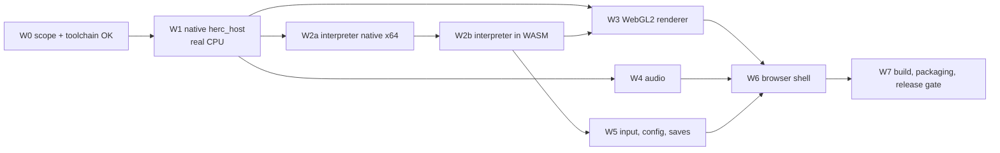

# WASM port — migration roadmap (W0–W7)

Each phase ends with a gate that can be checked on its own. The project runs lean (no test suites or evidence files):
a gate is a short check run once, with the result noted in the phase notes. Tasks are in
[implementation-backlog.md](implementation-backlog.md).

## Dependency graph

**Critical path:** W0 → W1 → W2a → W2b → W3 → W6. Audio (W4) runs in parallel once W1 has the sound slots.

## W0 — Release scope and decisions

| item | content |
|---|---|
| deliverables | Release-scope section added to `docs/authorization-scope.md`: local and LAN builds only. The user supplies HERCULES.FS, the 3 DLLs and HERCULES.EXE (for the sine table and a hash check). Originals and derived art are never hosted publicly. Public deployment stays blocked until the Disney licence is recorded. Decisions D-W0-1…4 recorded |
| decisions | **D-W0-1** web builds are local/LAN only (default yes). **D-W0-2** Emscripten SDK may be installed (third-party toolchain, rule 7). **D-W0-3** music: the user supplies their own track-2 rip, or there is no music. **D-W0-4** save persistence (I-02): behave like Windows, or persist to OPFS |
| gate | the decisions are written down; nothing is blocked by legal questions for local development |

Legal blockers (separate from engineering): public hosting of the app is fine only if it contains no game code or
derived art. Hosting any art bundle or recompiled code is blocked.

## W1 — Native C host on Windows x86 (`herc_host`)

| item | content |
|---|---|
| goal | replace HERCULES.EXE with our own C host while the real CPU runs the unmodified DLLs. This validates the platform layer before any emulator exists |
| deliverables | `runtime/host/*` (portable C), `runtime/herc_host/` (Win32 window, LoadLibrary of the DLLs from `working/game`, a 250-entry table of host function pointers). D3D11 drawing reuses `gpu_renderer.cpp`, refactored onto a `HostRenderState`. waveOut sound with ESF decode. Keyboard input. Config from `hercules_settings.ini`. Trace log (`tick, module, rva, slot, args, ret`) and a per-tick gameState+arena checksum |
| how | 1. table + boot + timing; 2. FS, heap and RNG slots (exact ports of `p2_decomp`); 3. GTE and VRAM slots; 4. `GFX_DrawOTag` → renderer; 5. input; 6. audio; 7. module switch with real `setjmp/longjmp` around the DLL call (native only) |
| depends | W0 |
| gate | (a) from boot without input, the title runs into the attract demo and back, with no fatal or unknown trap; (b) hero x/y/state per tick during the demo matches `analysis/traces/hero_state.csv` (ticks from 1135); (c) for 5 reference frames, `tools/runtime/gpu_diff.py` against the original's `soft_<n>.png` gives a mismatch no worse than the proxy's own `gpu_<n>.png` for the same tick; (d) password-select into one ENG1 and one ENG3 level (`reference/passwords.json`) loads and plays |

W1 isolates host bugs from CPU bugs. If W1 diverges, the cause is in the slot code. If W2 later diverges from W1, the
cause is in the interpreter.

## W2 — x86 interpreter (native x64 first, then WASM)

| item | content |
|---|---|
| goal | run the same DLLs without a real x86 CPU |
| deliverables | `runtime/cpu/`: PE loader with rebase and IAT traps, decoder with a decoded-instruction cache, integer core with lazy flags, x87 subset, KERNEL32 stubs (55), `cpu_call` with sentinel, abort for module switch, guard-page diagnostics. Opcode list generated from the Ghidra disassembly (`disasm_ENG*_DLL.json` + a TITLE export). `herc_host --interp` (x64). Emscripten build of host + cpu with a headless driver (no renderer) |
| measurements | guest instructions per tick (mean / p95 / max) over the attract demo, TRAINING, HYDRA, CYCLOPS and TORMENT; ms per tick native and in Chrome and Firefox; WASM size; memory peak |
| depends | W1 (trace format and host), D-W0-2 |
| gate | (a) the interpreter's trace and checksums equal W1's for the full attract-demo cycle and one ENG3 level entry (slot sequence, arguments, per-tick checksum); (b) no unknown opcode on those paths; (c) **performance gate: p95 ≤ 8 ms/tick in desktop Chrome and Firefox** on the reference machine (i9-10900K). If it fails after optimisation: go to static recompilation (`x86-execution-strategy.md` §5) |

## W3 — WebGL2 renderer

| item | content |
|---|---|
| goal | the D3D11 renderer's rules on WebGL2 |
| deliverables | `runtime/render/gl/`: OT walk (multi-OT per frame, extent rule 0x800, codes 0x24/0x2c/0x3c/0x64/0x74/0x7c/0xe1/0xf3/0x01), VRAM R8UI with dirty tiles, CIF tables, R16UI index target + RGBA8, semi-transparency via destination copy, fog/shade/brightness, clear rule, resolve to the canvas (4:3 integer and fit), art key FNV-1a-64 + bundle loader + LRU |
| depends | W1 (host render state), W2b (for in-browser runs) |
| gate | (a) on 10 reference frames (TITLE, TRAINING, HYDRA, GAUNTLET, CYCLOPS, TORMENT, UI) the WebGL output compared with `gpu_diff.py` against `soft_<n>.png` is within ±0.5 % of the D3D11 numbers recorded in `docs/gpu-renderer.md:90-94`; (b) art override keys for those frames equal the D3D11 key dump; (c) ≥ 60 fps presentation at 2560×1440 with 4× art in Chrome |

## W4 — Audio and music

| item | content |
|---|---|
| goal | SFX and music with the original voice behaviour |
| deliverables | host `sound.c` (Sonix banks, voice table at 0xa8e790/0xa8e7d0, slots 0x300–0x3a8 after RE of the DirectSound voice code 0xf940/0xfa10/0xfbf0/0xf710), C ESF decoder, JS voice graph. CD-segment player: TMSF → ms, the segment table from `MUSIC.MUS` records, resume after pause, volume gate gs+0x1b14 and the options flag. Import of a user track-2 file and per-segment decoding |
| depends | W1 (slots), W2b for the browser |
| gate | (a) the SFX event sequence (voice, id, volume) for the attract demo matches the original recorded in `extracted/meta/full-game/sfx-events.json` (and the run traces under `analysis/traces/full-game/`); (b) music segments start and stop at the documented times on title, password and VORTEX (same checks as `docs/music-transport.md`); (c) AudioContext starts only after the Play gesture |

## W5 — Input, configuration, persistence

| item | content |
|---|---|
| deliverables | keyboard map with the original default keys from the Config blob (key codes ≈0x1c–0x2e) and remapping UI. Gamepad API standard mapping → PSX bits (Up 0x10, Right 0x20, Down 0x40, Left 0x80, plus face/shoulder bits per `docs/demo-format.md`), with opposite-direction suppression like 0x8040. Optional touch overlay. Config blob in IndexedDB. Pause on `visibilitychange`/`blur` via the active flag. The save decision applied |
| gate | a password entered with a gamepad reaches the expected level; Config changes made in the in-game options survive a reload |

## W6 — Browser shell

| item | content |
|---|---|
| deliverables | `web/index.html` + JS: first-run import (hash check against `FACTS.md` values), Play button (gesture → `AudioContext.resume()`, `requestFullscreen()`, optional `navigator.keyboard.lock(['Escape'])` where supported), DPR-aware canvas, integer 4:3 + letterbox / fit / stretch modes, settings page mirroring `hercules_display.ini`, error screen, optional PWA (offline app shell only; game files stay in OPFS) |
| gate | from a clean browser profile: import → Play → title → demo → password → level, in Chrome, Firefox and Edge on Windows; Safari noted as a separate milestone |

## W7 — Build, packaging, release

| item | content |
|---|---|
| deliverables | `runtime/web/build.ps1` (emcc `-O3`, `-sALLOW_MEMORY_GROWTH=0` with fixed 128–256 MB, `-sMAX_WEBGL_VERSION=2`, debug profile with `-gsource-map` and `ASSERTIONS`), `tools/web/serve.py`, a zip of the web app with no game data, an art-bundle build step for local use, `docs/wasm/` updated with measured numbers |
| gate | the zip contains no original bytes and no derived art (checked by hashing every file against the archive payloads and the art manifest); full play-through of one level per engine in the browser |

## First implementation milestone (proof of concept)

**M1 = W1 steps 1–3 + W2a core on TITLE only:**
1. `herc_host` (real CPU) boots TITLE.DLL and runs 1,200 ticks to the attract-demo switch, with the trace log on.
2. `herc_host --interp` (x64 interpreter) runs the same 1,200 ticks. The traces and checksums match.
3. The emscripten headless build of (2) runs in Chrome and prints ms/tick.

M1 shows that the platform table, the module switch and the interpreter all work, and gives the first real
performance number. It needs no renderer or audio: drawing slots can be null traps that only count primitives.

## Go / no-go before committing to the full port

| # | criterion | source |
|---|---|---|
| 1 | W1 gate (a)–(b): the attract demo is correct on our host with the real CPU | W1 |
| 2 | the interpreter matches the native traces for the demo cycle and one ENG3 entry | W2 gate (a) |
| 3 | p95 guest time ≤ 8 ms/tick in desktop Chrome and Firefox, or a costed decision to build the recompiler | W2 gate (c) |
| 4 | WebGL2 frames match D3D11 on the reference set | W3 gate (a) |
| 5 | W0 decisions recorded (local/LAN scope, Emscripten approved) | W0 |
