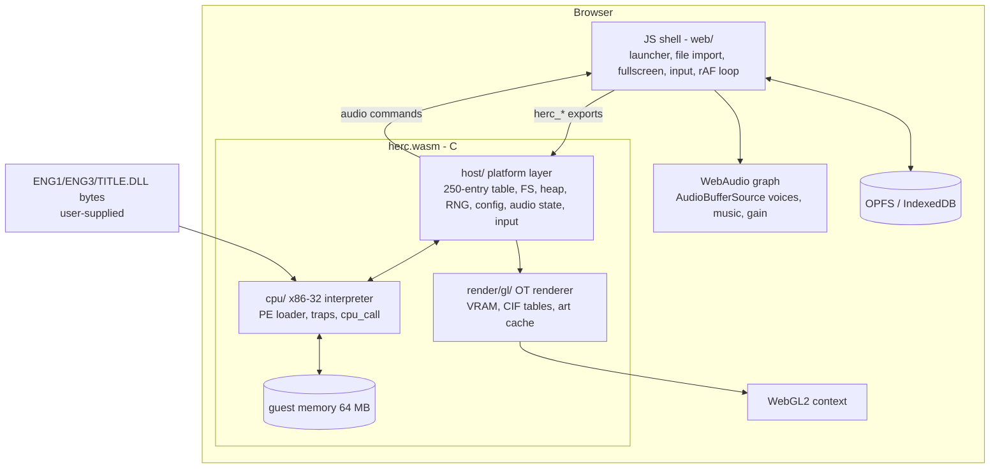
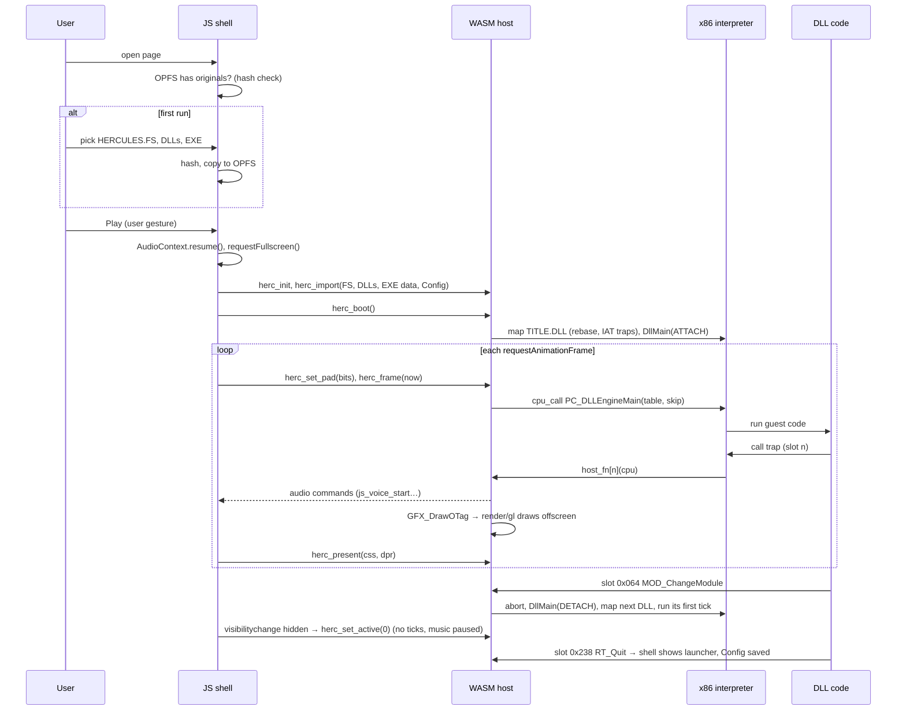

# WASM port — target architecture

Goal: the original DLL game logic runs **entirely on the client**, in a browser tab. A C host compiled to
WebAssembly provides the 250-entry platform table. An x86 interpreter executes the DLLs, and a WebGL2 port of the
existing renderer draws the frames. The server, if any, only serves the web app (and, on a LAN, locally built art).

## 1. Layering

## 2. Source layout (fits the existing repo)

New code sits next to today's runtime. There is no parallel `hercules-web/` tree.

| path | content | built for |
|---|---|---|
| `runtime/host/` | platform layer in portable C11: `table.c` (slot traps → handlers), `fs.c` (index, hash, 16 handles), `heap.c` (port of `RT_*Malloc`), `rng.c`, `gte.c`, `vram.c` (port of slots 0x204/0x20c/0x208), `sound.c` (Sonix banks, voices, CD-segment state), `input.c`, `config.c` (0x48-byte blob), `boot.c` (port of `FUN_00401ff0`, `RT_Tick` timing), `trace.c` | W1 native x86, W2 native x64, WASM |
| `runtime/cpu/` | `pe.c` (map, rebase, IAT), `x86.c` (decoder and executor), `x87.c`, `k32.c` (KERNEL32 stubs), `cpu_call.c` | W2 native x64, WASM |
| `runtime/herc_host/` | Win32 driver for W1/W2a: window, `LoadLibrary` path (W1) or interpreter path (W2a), D3D11 presentation via the existing `runtime/display/gpu_renderer.cpp` refactored to read a `HostRenderState` instead of EXE globals, waveOut/XAudio for sound | Windows |
| `runtime/render/gl/` | WebGL2 renderer: C port of the OT walker plus GLSL ES 3.0 shaders translated from the inline HLSL (`gpu_renderer.cpp:94-175`) | WASM (and native via ANGLE only if ever needed) |
| `runtime/web/` | emscripten entry (`main_web.c`), `library_herc.js` (EM_JS bindings for audio and storage), `build.ps1` | WASM |
| `web/` | shell: `index.html`, `herc.js` (loader, import UI, input mapping, loop), `audio.js`, `storage.js`, `settings.js`, optional `sw.js` (PWA) | browser |
| `tools/hires/bundle.py` | art bundles per level and scale (extends `atlas.py`) | offline |
| `tools/web/serve.py` | local or LAN dev server with correct MIME types (no COOP/COEP needed) | dev |

`runtime/display/` (the shipping Windows proxy, Route A) stays as it is. The web host copies its rules (renderer,
CD segments, Config blob) rather than sharing code with it, so the shipping build carries no risk.

Third-party toolchain: the user approved Emscripten under rule 7 on 2026-10-13 (decision D-W0-2). SDK **6.0.12**
is installed outside the game folder; see [toolchain.md](toolchain.md) for activation and reproduction.
SDL is **not** needed: the W1 host uses plain Win32 and the existing D3D11 code.

## 3. Ownership

| concern | owner | notes |
|---|---|---|
| tick cadence (33 ms, ±66 ms clamp, ≤2 catch-up ticks with skipRender) | host `boot.c` (port of `RT_Tick` 0x5f20) | driven by `herc_frame(now)` from rAF |
| game logic | original DLLs in the interpreter | unchanged |
| module switch | host + cpu (abort / reload) | `x86-execution-strategy.md` §3.5 |
| guest memory layout | cpu (images, stack, CRT heap) + host (table, gameState, arena, data blocks) | |
| archive | host `fs.c` over an in-memory copy of HERCULES.FS | |
| VRAM, CIF tables, palette, draw env, brightness | host `vram.c`/`gfx_state` (the EXE globals become host struct fields) | read by the renderer |
| drawing | `render/gl` | at `GFX_DrawOTag`, into an offscreen R16UI index target + RGBA8 colour target |
| presentation | `render/gl` resolve pass at every rAF | 4:3 integer scale + letterbox |
| SFX/music state | host `sound.c` (voices, banks, segment table) | emits commands |
| audio output | JS `audio.js` | one AudioBufferSource per voice start; GainNode/StereoPanner; `playbackRate` for pitch |
| input | JS maps keyboard/gamepad → PSX pad bits → `herc_set_pad(bits)` once per rAF; the host latches per tick | |
| settings, Config, saves | JS storage ↔ host `config.c` | |

## 4. JS ↔ WASM interface

Exports (C, `EMSCRIPTEN_KEEPALIVE`):

| function | purpose |
|---|---|
| `int herc_init(const HercInit*)` | sizes, scale, art scale, flags |
| `void* herc_alloc(int n)` / `int herc_import(int kind, void* p, int n)` | hand imported files (FS, DLLs, EXE data, Config) to the host |
| `int herc_boot(void)` | boot (`FUN_00401ff0` port), load TITLE |
| `int herc_frame(double now_ms)` | run 0–3 ticks per the `RT_Tick` rules, draw, return status (running, quit, fatal) |
| `void herc_present(int css_w, int css_h, double dpr)` | resolve the last frame to the canvas |
| `void herc_set_pad(uint16 bits)` | current pad state (active-high in JS, inverted in the slot) |
| `void herc_set_active(int)` | page visible or focused → mirrors 0xba0238 |
| `int herc_art_need(char* out, int max)` / `herc_art_put(key, w, h, scale, rgba_or_index, n)` | art streaming |
| `int herc_get_config(void* out)` | 0x48-byte blob for persistence |

Imports (JS functions called from C via `EM_JS`/`library_herc.js`):

| function | purpose |
|---|---|
| `js_sfx_create(id, rate, pcm_ptr, n, loop)` / `js_voice_start(voice, id, vol, pan, pitch)` / `js_voice_stop(voice)` / `js_voice_set(...)` | audio |
| `js_music_play(startMs, endMs)` / `js_music_stop()` / `js_music_volume(v)` | CD-segment music |
| `js_log(level, msg)`, `js_fatal(msg)` | errors |
| `js_save_write(name, p, n)` / `js_save_read(...)` | only if saves persist (I-02) |

WebGL calls go through Emscripten's GLES3 → WebGL2 bindings (`-sMAX_WEBGL_VERSION=2 -sMIN_WEBGL_VERSION=2`).

## 5. Execution sequence

## 6. Timing model

- rAF gives `now`. The host runs `RT_Tick`'s rules unchanged:
  1. `acc += now − last`, clamped to ±66 ms;
  2. while `acc ≥ 33` (at most 2), run a tick with skipRender = 1;
  3. then one tick with skipRender = 0, and `acc −= 33`.
- The present rate (60/120/144 Hz) never changes the tick rate. On rAF frames without a rendering tick, the last resolved image is blitted again.
- The original only ticks when it is the active app (0xba0238), so a hidden tab produces no ticks and no catch-up burst on return. That is the clamp's job too.
- Browser rAF throttling in background tabs is therefore harmless.

## 7. Renderer translation notes (WebGL2)

| D3D11 today | WebGL2 |
|---|---|
| `R8_UINT` VRAM 2048×1024, `Texture2D<uint>.Load` | `R8UI` + `usampler2D` + `texelFetch` (integer textures need NEAREST, no mipmaps) |
| `R16_UINT` index target | `R16UI` is colour-renderable in ES 3.0. Integer targets cannot blend, which matches today's design: semi-transparency reads a **copy** of the destination (`PSSemi`, `:838-854`) |
| `RGBA8` colour target + copy | `RGBA8` FBO + `copyTexSubImage2D` / `blitFramebuffer` of the run's box |
| dual targets in one pass (MRT) | `drawBuffers([COLOR_ATTACHMENT0, 1])` with mixed int/float attachments is allowed; outputs are typed per attachment |
| `discard` on texel 0 | same |
| `D3DCompile` at run time | GLSL ES 3.00 sources embedded in C, compiled at boot |
| per-frame table uploads (palette, fog, blend, shade) | `texSubImage2D` on change only (dirty flags set by the host slots) |
| dirty VRAM tiles (32×32 stamps, `:258-286`) | same; uploads by row range |
| worker-thread PNG loads | browser `createImageBitmap` / `ImageDecoder` in JS → `herc_art_put`; indexed PNGs need the palette indices, so decode with a small C PNG inflater or keep raw indices in the bundle (decision W3-05) |

WebGPU: a later backend behind the same `render` interface. Not needed for the first playable build.

## 8. Threads and isolation

Single-threaded WASM, no SharedArrayBuffer, so **no COOP/COEP headers**. Audio uses plain AudioBufferSourceNodes
scheduled from the main thread, not an AudioWorklet fed from shared memory. If profiling later shows the interpreter
blocking the main thread for too long, the CPU and host can move into a Worker with an OffscreenCanvas. That
change still doesn't need cross-origin isolation.
